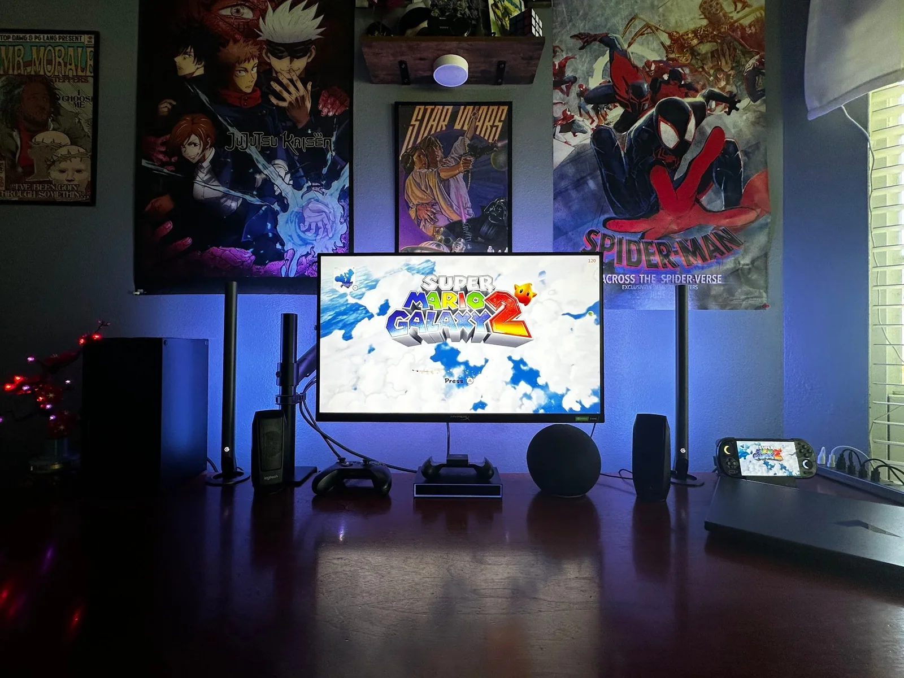
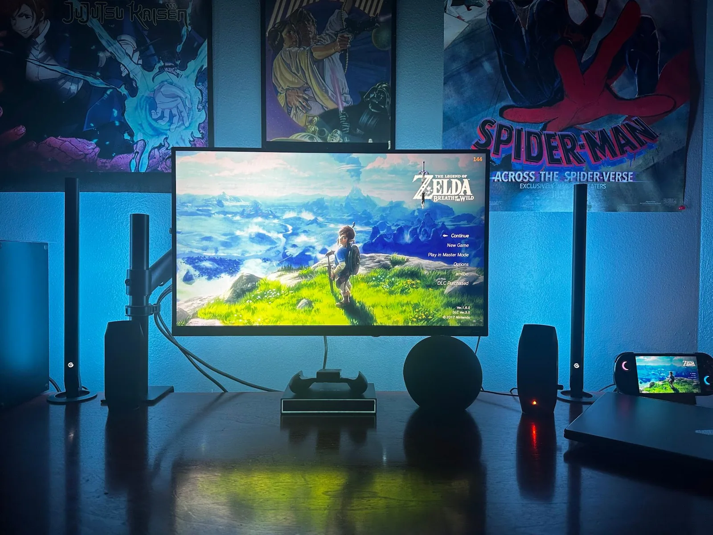
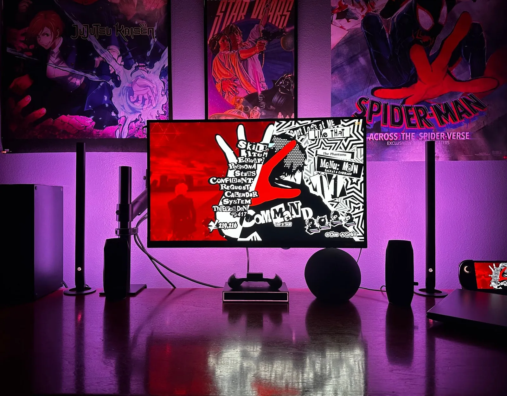

A personal project on a handheld gaming device. I flashed custom firmware and reconfigured the system settings to get it running the way I wanted.

I truly love this device. It's essentially a powerful phone, but it can run AAA titles natively at 60 fps. I use ES-DE as my front end, so my whole catalogue lives in one place.

## Troubleshooting

Along the way I ran into software compatibility issues and worked through them one at a time. Then I tuned performance with hands-on troubleshooting:

- **Editing drivers** to get games working properly
- **Testing different Wine components** until a game would run
- **Reducing the resolution** to free up performance
- **Unlocked-FPS hacks** for games capped below what the device can do

A lot of it came down to balancing how a game looks against how smoothly it runs. It's the kind of problem I like: something doesn't work, and you keep narrowing it down until it does.

## At my desk

Here it is next to my monitor, running the same games.

