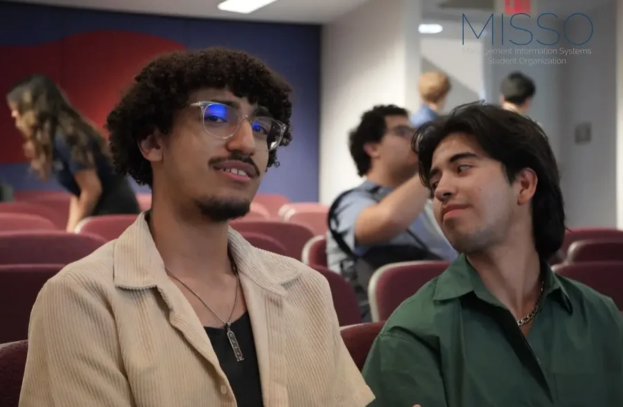

Since Spring 2025 I've been on the Operations Committee of MISSO, the Management Information Systems Student Organization at the University of Houston.

- I help set up and run MISSO events.
- I attend workshops, guest speaker events and networking sessions with MIS professionals.
- Company tours, case studies and hands-on sessions show me how technology is actually used in business.

